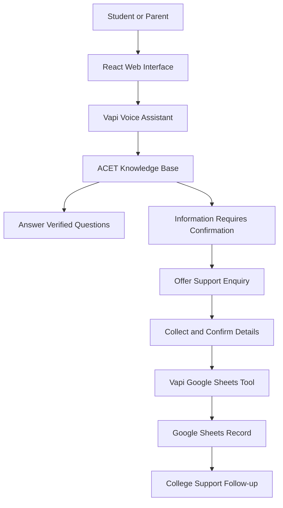

# ACET AI Voice Support Agent

An AI-powered voice support assistant for B.Tech admissions and student enquiries at Aditya College of Engineering and Technology (ACET).

## Project Overview

The ACET AI Voice Support Agent helps prospective students, parents, and existing students obtain college information through natural voice conversations. It uses a verified knowledge base to answer supported questions and can collect support enquiries when information requires confirmation.

This project is developed as a PW Medharthi Capstone Project.

## Problem Statement

Students and parents often need information about B.Tech programmes, admissions, eligibility, hostel facilities, transport, and other college services. Finding the correct information may require visiting multiple sources or contacting college staff.

The ACET AI Voice Support Agent provides a conversational interface where users can ask questions naturally. The assistant answers using its configured ACET knowledge base, avoids guessing when information is unavailable or requires current verification, and offers to collect enquiries for follow-up by the college support team.

## Objectives

- Provide a simple voice-based college information service.
- Answer supported B.Tech questions using the configured knowledge base.
- Handle admission and student-support enquiries.
- Collect and confirm enquiry details before submitting them.
- Store submitted enquiries in Google Sheets through a Vapi tool.
- Handle unknown questions and failed submissions honestly.
- Provide a responsive, accessible web interface.

## Key Features

- AI-powered voice conversations.
- College information and B.Tech admission support.
- Knowledge-base-based answers.
- Support enquiry collection and confirmation.
- Google Sheets integration for enquiry storage.
- Error handling for failed voice or enquiry operations.
- Responsive React web interface.

## Technology Stack

| Component | Technology |
|---|---|
| Frontend | React |
| Development and build tool | Vite |
| Voice assistant platform | Vapi |
| Language model | OpenAI model configured in Vapi |
| Speech recognition | Soniox, configured in Vapi |
| Enquiry storage | Google Sheets |
| Deployment | Vercel |
| Version control | Git and GitHub |

## System Architecture



## Live Demo

https://acet-ai-voice-support-agent.vercel.app/

## GitHub Repository

https://github.com/Indra-sekhar/ACET-AI-Voice-Support-Agent

## Run Locally

### Prerequisites

- Node.js and npm
- Git
- A Vapi account
- A configured Vapi assistant

### Installation

Clone the repository:

```bash
git clone https://github.com/Indra-sekhar/ACET-AI-Voice-Support-Agent.git
cd ACET-AI-Voice-Support-Agent
```

Enter the frontend directory and install dependencies:

```bash
cd frontend
npm install
```

Create a `.env` file inside `frontend/` with the following variable names:

```env
VITE_VAPI_PUBLIC_KEY=your_vapi_public_key
VITE_VAPI_ASSISTANT_ID=your_vapi_assistant_id
```

Replace the placeholder values with your actual Vapi public key and assistant ID. Never commit `.env` files or private API keys to GitHub.

Start the development server:

```bash
npm run dev -- --host 0.0.0.0
```

Build the production frontend:

```bash
npm run build
```

## Google Sheets Integration

The Vapi `create_support_enquiry` tool is configured to append submitted enquiries to a Google Sheet.

The assistant should collect the required details, read them back for confirmation, and submit the enquiry only after the user agrees. A successful submission should be reported only when the tool confirms success.

The spreadsheet may contain personal information. Access should be restricted to authorized users, and collected data should be handled responsibly.

## Safety and Limitations

- The assistant must not invent college information.
- Current fees, admission deadlines, seat availability, and policies must be verified before being stated as facts.
- Unknown or sensitive enquiries should be directed to the appropriate college support team.
- The assistant must not claim that an enquiry was saved when the submission fails.
- Responses depend on the accuracy and freshness of the configured knowledge base.
- This prototype does not replace official college admission decisions or human support.

## Testing

The project includes a planned set of test scenarios covering knowledge-base answers, current admission enquiries, clarification, correction of details, enquiry confirmation, Google Sheets storage, and failure handling.

Actual results and supporting evidence should be recorded in `docs/testing-report.md`. Only tests that have been executed and verified should be marked as passed.

## Project Documentation

The following documentation will be maintained in this repository:

- `docs/problem-statement.md`
- `docs/project-overview.md`
- `docs/architecture.md`
- `docs/knowledge-base.md`
- `docs/conversation-flows.md`
- `docs/system-prompt.md`
- `docs/testing-report.md`
- `docs/challenges-and-solutions.md`
- `prompts/` — prompt versions and improvements

## Future Enhancements

- Expand support to additional academic programmes.
- Improve multilingual conversations.
- Add an authorized staff dashboard for managing enquiries.
- Improve enquiry tracking and follow-up status.
- Expand testing with additional real-world conversation scenarios.

## Project Status

The core voice prototype and Google Sheets enquiry workflow have been tested. Documentation, consolidated test evidence, and final submission preparation remain in progress.

## Author

Developed by Indra Sekhar as a PW Medharthi Capstone Project.
