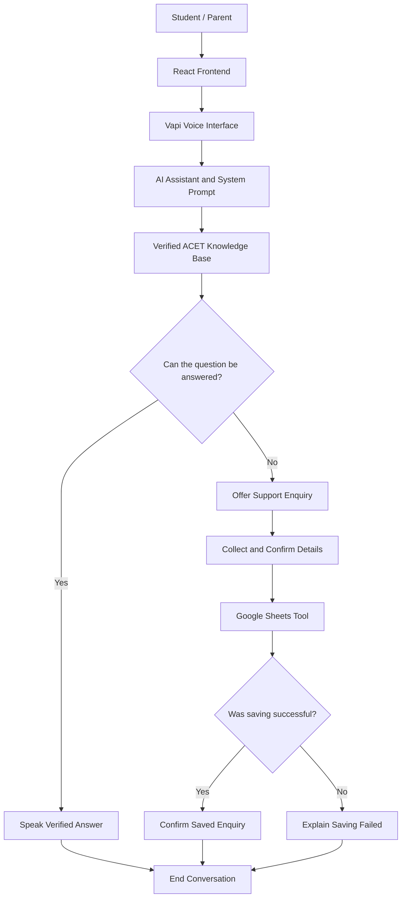

# ACET AI Voice Support Agent — Architecture

## System Overview

The system allows prospective B.Tech students, parents, and current students to ask college-related questions using a voice assistant. It answers from the verified ACET knowledge base and can save confirmed support enquiries to Google Sheets.

## Architecture Diagram

## Technology Stack

- Frontend: React and Vite
- Voice assistant: Vapi
- AI model and speech services: Configured through Vapi
- Knowledge source: ACET B.Tech knowledge base
- Enquiry storage: Google Sheets integration
- Repository: GitHub
- Hosting: Vercel, subject to deployment verification

## Data Flow

1. The user opens the React website and starts a voice conversation.
2. Vapi manages the voice interaction with the configured AI assistant.
3. The assistant uses its system prompt and knowledge base to answer ACET-related questions.
4. If verified information is unavailable, the assistant offers to create a support enquiry.
5. The assistant collects the required details and asks the user to confirm them.
6. The Google Sheets tool attempts to save the enquiry.
7. The assistant reports success only when the tool succeeds; otherwise, it reports the failure.

## Safety and Reliability

- Do not invent college information, fees, deadlines, or policies.
- Ask for confirmation before saving an enquiry.
- Do not claim that an enquiry was saved when the tool fails.
- Avoid collecting unnecessary personal information.